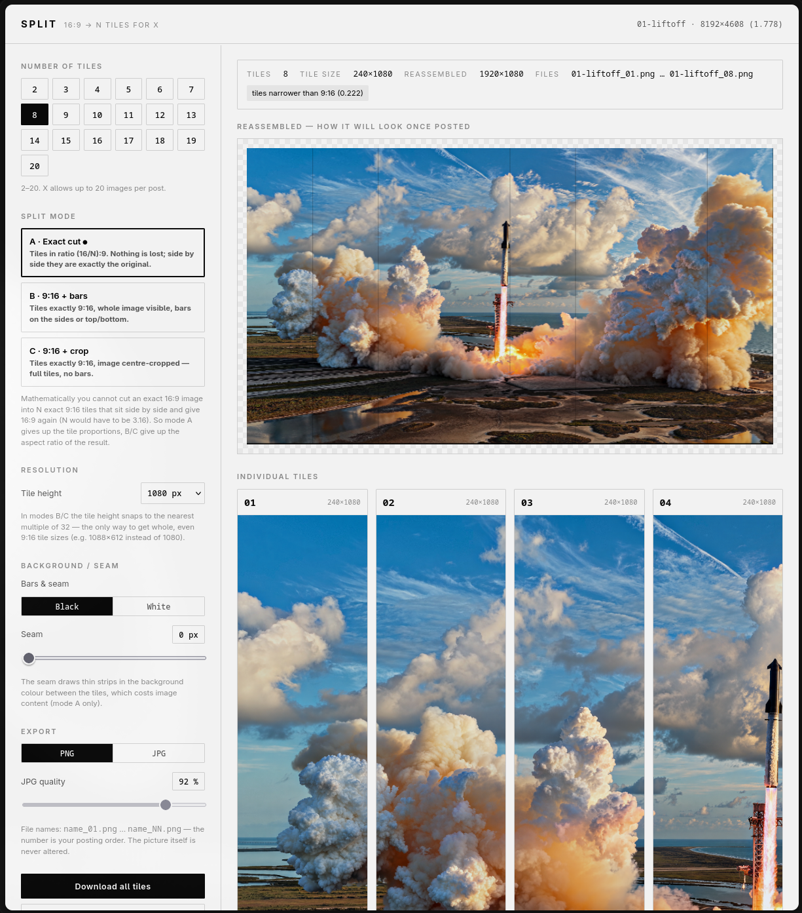

# SPLIT

**Cut one image into up to 20 tiles that reassemble into the original — for X multi-image posts.**

A single-file, offline web app. Drop in one image, choose how many pieces you want (2–20), and download the pieces numbered `01 … NN`. Post them in order on X (which now allows up to 20 images per post) and they line up side by side back into the full picture.

No build step, no dependencies, no install: open `index.html` in any modern browser.



## Use

1. Open `index.html` (double-click, or drag it into a browser tab).
2. Drop an image onto the page, click to pick a file, or paste from the clipboard (`Ctrl/Cmd + V`). PNG, JPG and WebP work.
3. Pick the number of tiles (2–20) and a split mode (A / B / C below).
4. Pick a tile height (1080 / 1440 / 2160 / original) and PNG or JPG.
5. Download the tiles one by one, or **Download all tiles**.

File names come out as `name_01.png`, `name_02.png`, … `name_NN.png`, where `name` is your original file name. The number is your posting order — post `01` first, then `02`, and so on. The tiles are numbered only in the file names; the pixels are never touched, so nothing (no label, no watermark, no badge) is drawn onto your picture.

The panel at the top of the results shows the tile size, the assembled size, the exact file names, and what the current mode costs you. The preview labelled **“Reassembled”** shows what the post will actually look like once the tiles are put back together.

## The maths, and the three modes

Here is the catch worth knowing before you use it: **you cannot cut an exact 16:9 image into N exact 9:16 tiles that sit side by side and give 16:9 again.**

If a tile is 9:16, its width/height is `9/16`. A row of N tiles is therefore `N · 9/16` wide relative to its height. Setting that equal to 16:9:

```
N · 9/16 = 16/9   →   N = 256/81 ≈ 3.16
```

No whole number works — and the same argument rules out any grid arrangement, not just single rows. One of the three wishes has to go: *exact tile ratio*, *exact reconstruction*, or *nothing cropped*. So SPLIT offers three trade-offs:

| Mode | Tile ratio | Reconstruction | Content lost |
|---|---|---|---|
| **A · Exact cut** (default) | `(16/N) : 9` | pixel-exact | none |
| **B · 9:16 + bars** | exactly `9:16` | pixel-exact | none (bars instead) |
| **C · 9:16 + crop** | exactly `9:16` | pixel-exact | cropped |

- **A · Exact cut** — the image is sliced into N equal columns at full height. Nothing is cropped, nothing is padded, and placing the tiles side by side reproduces the original exactly. The trade-off is tile proportions: with N = 8 from a 1920×1080 source you get 240×1080 tiles (ratio 0.222, narrower than 9:16); with N = 2 you get 960×1080 (0.889, wider than 9:16). For small N the tiles are very narrow, and X crops tiles in its grid preview anyway.
- **B · 9:16 + bars** — every tile is exactly 9:16, the whole image is visible, and the leftover space is filled with black or white bars. Side by side you get a `N·9 : 16` strip containing your full picture. Best results around N ≥ 14, where the strip is close to square and the bars are modest.
- **C · 9:16 + crop** — every tile is exactly 9:16, filled edge to edge with the image, centre-cropped. No bars, full tiles, and you lose the parts of the picture that fall outside the crop. The info bar tells you how much survives (“only X % of the original visible”).

The seam slider draws thin strips of the background colour between tiles; use it if you want visible grout lines, and be aware it removes a few pixels of image content.

## How it works

Everything happens in a `<canvas>` in your browser:

- **Slice geometry.** `geom()` computes the tile size and the size of the assembled strip. Tile dimensions are always whole, even numbers (`even()`), which keeps JPEG encoders happy, and in modes B/C the tile height snaps to a multiple of 32 (`snap32()`) so that `width = height · 9/16` comes out as a whole, even number — e.g. 1088×612 is exactly 9:16, while 1080 would want a 607.5 px wide tile.
- **Placement.** `fit()` works out the scale and offset of the image inside the assembled strip: exact for A, contain for B, cover for C. Offsets are **rounded to integers**, which is what makes the seams line up: with an integer offset and an integer tile width, every tile samples the source on the same pixel phase, so tile edges meet without half-pixel blur or a 1 px gap.
- **Painting.** `paint()` renders tile *i* by drawing the image at `ox − i·tileWidth`; tiles are rendered at full export size only when you download one, so previews stay cheap even at 2160 px and 20 tiles.
- **Export.** `canvas.toBlob()` writes PNG or JPG (quality slider), and a temporary `<a download>` triggers the browser download.

Correctness is checked by construction: reassembling the exported tiles reproduces the assembled strip pixel-for-pixel (verified across modes, tile counts 2–20, and both 16:9 and 4:3 sources).

## Privacy

Nothing leaves your machine and nothing is stored:

- No network requests at all — no `fetch`, no CDN, no fonts, no analytics, no tracking pixels. The file has no external references whatsoever.
- No cookies, no `localStorage`, no `sessionStorage`, no IndexedDB. The only state is JavaScript variables in the current tab.
- Your image is read with `URL.createObjectURL()` and drawn on a canvas; it is never uploaded, and the page works with the network disabled (the only network-adjacent step is your browser saving the files you download).
- Exported tiles are re-encoded from canvas pixels, so any EXIF/GPS metadata or camera information in your original file is dropped from the tiles.
- Tile file names are derived from your own file name — that stays on your disk, and it is worth a glance before posting if a name contains something private.

## Browser support

Any current Chromium, Firefox or Safari desktop browser, including mobile. Needs `canvas.toBlob()`, which every modern browser has. No server required: `file://` works.

## Files

```
index.html     the whole app — open this
README.md      this file
LICENSE        Apache 2.0
screenshot.png preview of the UI
```

## License

Apache 2.0 — see `LICENSE`.
